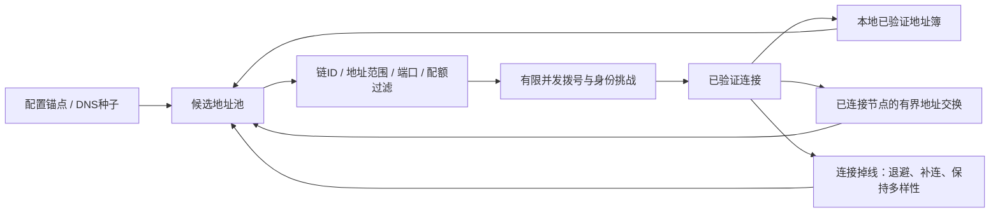

# PureEOS P2P 自发现：现状与独立改造方案

日期：2026-10-29  
核对基线：3a3f9361bdfb49a3be355dff2f5b3fb249bfd191  
状态：设计分析，尚未实现普通节点自发现；本文件不表示该功能已上线或通过测试。

## 1. 建议结论

普通节点采用“少量可信引导入口 + 有界地址交换 + 独立地址簿 + 自动拨号与补连”。保留现有静态 peer 和 BP 专用互联机制。第一阶段沿用当前 TCP/P2P 传输，不直接替换为整套 libp2p，也不把 DHT、自动端口映射和中继一起纳入首版。

BP 与普通节点分两条路径：

- BP 专用自动互联：已有上游代码，可评估复用；依赖本链的 BP 资格、peer-key 注册/查询和签名配置，不能等同普通节点自动发现。
- 普通节点发现：新增不依赖系统合约的节点身份与地址交换。发现到一个节点，只说明可尝试连接，不赋予其 BP、finalizer 或治理权限。

建议在独立的 `feature/p2p-discovery` 分支开发，保持当前并行开发基线和吞吐实验可复现。开发默认已选择 CPU16／NET16MiB；进行中的参考测试仍使用原 CPU32／NET32MiB。自发现不改变这两类参数、资源计费、现有投票、出块/终局/轮换、奖励减半或 RAM1024 初始化规则。

## 2. 当前源码已经有什么

以下是对本项目实际源码的核对，不是把上游最新版本功能直接视作本链已经部署。

| 已有能力 | 本项目位置 | 实际边界 |
|---|---|---|
| 静态连接、公布自身地址 | `net_plugin.cpp` 的 `p2p-peer-address`、`p2p-server-address` | 需预先知道地址；公布自身地址不等于发现全网 |
| 根据 BP 集合自动连接 | `p2p-auto-bp-peer`、`auto_bp_peering.hpp` | 地址来自配置或已认证 BP 信息；不是普通节点地址簿 |
| BP 签名地址 gossip | `p2p-bp-gossip-endpoint`、`gossip_bp_peers_message` | 有 BP 身份/peer-key 依赖；当前测试没有启用 |
| 类型化连接 | `host:port:trx`、`host:port:blk` | 已支持交易/区块通道选择；纯验证跟随者与公共交易入口的需求不同 |
| 基本认证、去重、重连、同步 | `authenticate_peer`、连接管理和同步管理代码 | 能作为基础复用，不能替代新地址消息的独立安全验证 |

关键定位：

- [net_plugin.cpp：配置入口](/home/guagua/AntelopeIO/PureEOS-group8-baseline-20261029/plugins/net_plugin/net_plugin.cpp:4403)
- [auto_bp_peering.hpp：BP 连接和 gossip 管理](/home/guagua/AntelopeIO/PureEOS-group8-baseline-20261029/plugins/net_plugin/include/eosio/net_plugin/auto_bp_peering.hpp:18)
- [protocol.hpp：现有消息布局](/home/guagua/AntelopeIO/PureEOS-group8-baseline-20261029/plugins/net_plugin/include/eosio/net_plugin/protocol.hpp:143)
- [controller.cpp：读取系统合约 peer keys](/home/guagua/AntelopeIO/PureEOS-group8-baseline-20261029/libraries/chain/controller.cpp:1344)
- [net_plugin.cpp：现有握手认证](/home/guagua/AntelopeIO/PureEOS-group8-baseline-20261029/plugins/net_plugin/net_plugin.cpp:4285)

现有 BP 地址记录的签名摘要包含 chain_id 和 BP 地址记录；代码有每个 BP 最多 8 条记录、约 1 小时到期、约 30 分钟刷新等规则。复用时仍须核对本链的生产者/finalizer/轮换模式，不能直接照搬其他链的 Top21/Top50 和投票门槛。

## 3. BP 之间能不能自发现，以及主网是否使用

### 3.1 官方已发布支持

Spring v1.2.0 已正式提供 BP Gossip 自动互联。官方方案要求注册 peer key、配置 BP gossip endpoint 和对应签名器；至少先连上一台已参与的引导 peer，随后学习其他 BP 地址。它是运营者选择启用的机制，不是所有节点安装新版本后自动开启。该功能还依赖支持接口的系统合约版本。[Spring v1.2.0 发布说明](https://github.com/AntelopeIO/spring/releases/tag/v1.2.0)、[官方配置指南](https://github.com/AntelopeIO/spring/wiki/BP-Gossip-Peering-Instructions)

### 3.2 EOS／Vaulta 主网的实际公开证据

Antelope 是技术栈，不是所有采用它的链共用一个配置。如果这里指 EOS／Vaulta 主网，2026-10-29 15:20 UTC 通过两个独立公共 RPC 做了只读查询：

| 入口 | 核对结果 |
|---|---|
| https://eos.greymass.com | chain_id 匹配 EOS 主网；系统 ABI 包含 regpeerkey/getpeerkeys/delpeerkey；peerkeys 表返回 14 条，more=false |
| https://eos.api.eosnation.io | 相同 chain_id；相同接口和 14 条注册记录，more=false |

chain_id：`aca376f206b8fc25a6ed44dbdc66547c36c6c33e3a119ffbeaef943642f0e906`。

这能证明主网已部署支撑接口，并有账号注册了 peer key。注册记录不能单独证明该账号当前运行 gossip relay，也不能证明全部活跃 BP 都已启用或当前互联拓扑完整。实际启用还要看 BP 的私有配置与运行信息。公共 API 节点的软件版本也不能直接代表该运营者的 BP relay 版本。

本次查询方法：get_info、get_abi(eosio)、get_table_rows(code=eosio,scope=eosio,table=peerkeys,limit=100)。查询记录保存在：
`release-work-20261029/group8-repeat-multimachine-1/EOS_MAINNET_BP_GOSSIP_PUBLIC_PROBE.json`。

### 3.3 当前 PureEOS 的限制

核对本项目发布合约 ABI，并确认对应 WASM SHA256 为：
`fc639b60009090cb66424a58b9112fdb87309391a286905a0669ae3397289186`。

该 ABI 没有 `regpeerkey`、`getpeerkeys`、`delpeerkey`，也没有 `peerkeys` 表。配套发布合约源码同样未查到这些接口。当前三机测试使用显式静态 peer，不能称为已经测试过 BP 自发现。

因此，现有 BP gossip 不能仅靠打开一个配置项就视为可用。两种后续选择：

1. 保持系统合约不变，先实现普通节点地址发现；BP 仍使用现有静态/自动连接配置。
2. 独立设计最小 peer-key 接口与 BP 集合适配，再评估复用 BP gossip。接口会改变系统 WASM，必须另行版本化、构建和验证，保留本链全部治理与资源模式。不能直接用上游系统合约替换当前合约。

普通节点自发现不应强制依赖所有节点上链注册，也不应把未经认证的 BP 名称声明当作 BP 身份。

## 4. 目标流程

“自发现”减少逐台维护完整 peer 列表的工作，仍需要至少一种可信的首次引导来源。它也不能绕过 NAT、防火墙或把不可达地址自动变成可达。

首次启动：读取静态锚点和少量种子，找到可连接节点，完成同链握手，再获取少量地址。
正常运行：维护有限连接；低频更新自身地址与候选；不反复向全网洪泛。
断线：优先已验证的替代地址，指数退避并加随机抖动。
全部种子失效：利用本地曾验证地址恢复；如果从未有过任何入口，就明确报告无法引导。

## 5. 第一阶段模块

| 模块 | 工作内容 |
|---|---|
| Bootstrap provider | 读取配置种子、DNS A/AAAA；可选固定可信 HTTPS 签名列表。种子只提供入口，不裁定链的真伪 |
| Peer address book | 未验证/已验证分区；记录身份、地址、来源、成功/失败、最近验证时间、到期与重试时间 |
| Discovery protocol | 请求/响应少量签名地址，消息与字段均有严格上限 |
| Dial scheduler | 连接预算、并发、超时、退避、重复拨号抑制与多样性选择 |
| Identity verifier | 验证独立节点密钥、同链身份、会话挑战、地址记录签名及撤销/轮换 |
| Local persistence | 地址簿独立存放并原子更新；损坏可隔离重建，不能写入共识数据库 |
| Metrics | 候选数、来源分布、拨号结果、地址拒绝原因、发现流量和队列占用 |

第一阶段不实现 DHT、自动路由器端口映射、通用中继、浏览器传输和复杂 NAT 穿透。它们各有新的身份、资源与攻击面，需要独立设计。Kademlia 是完整的路由/查找子系统；AutoNAT 用于判断地址可达性，不能单独替代节点引导与发现。[libp2p Kademlia 规范](https://github.com/libp2p/specs/tree/master/kad-dht)、[AutoNAT v2 规范](https://github.com/libp2p/specs/blob/master/autonat/autonat-v2.md)

## 6. 身份、地址和链的绑定

### 6.1 独立身份

为普通节点使用独立的 P2P 身份密钥，沿用现有支持的密码库。私钥与出块、finalizer、治理、账号及 SSH 私钥分离，文件限制权限，日志不输出私钥。

可将规范化公钥的摘要作为持久节点身份。当前握手中的临时 node_id 不应未经评估就当作跨重启的可信身份。

当前 `allowed-connection=any` 路径会直接放行握手认证。新地址记录不能以“握手已通过”作为签名验证完成的依据，必须独立验证。

### 6.2 签名内容

签名覆盖：域分离标识、记录版本、chain_id、身份公钥、地址族/IP/端口、能力声明、签发时间、到期时间与必要的防重放信息。序列化必须规范、确定。

握手挑战使用新鲜 nonce，并绑定当前会话与期望身份。旧的时间 token 不能自动视为签名绑定了所有 endpoint、node_id 和能力字段。

签名只能证明某个密钥签署了记录，不能证明它诚实、具备 BP 权限，或真正控制声明的网络地址。连接后还须校验对端身份；首次未验证地址不能直接被大量转发。

### 6.3 地址和可达性

首期 gossip 只支持规范化 IPv4/IPv6 和 TCP 端口，DNS 用于配置种子，减少任意字符串解析与重绑定面。

公网模式拒绝 loopback、私网、链路本地、云元数据地址及其他禁止范围。IPv4-mapped IPv6 等等价表示要先归一化。端口采用明确策略，不能让发现消息变成任意内网或端口扫描器。私网/VPC 必须用独立配置的允许 CIDR，不把公网过滤自动关闭。

已签名地址仍可能不可达。NAT 节点先保持出站连接；公网可达性另行验证。不得根据一条 peer 消息自动开放本机/云防火墙或操作路由器。

BP 应公布合适的 relay 入口，避免普通公开地址交换暴露私有出块核心地址。认证与访问控制不等同传输加密。

## 7. 有界协议与兼容

当前能力协议版本最高为 12；现有 net_message 有 14 个类型，其 variant 索引为 0–13。二者是不同编号空间。

建议新增 `peer_exchange_request` 与 `peer_exchange_response`，类型仅追加在 variant 尾部，不移动现有索引。新增能力版本可考虑下一个未用版本，但最终编号需要与本分支及上游合并策略一起核对。

只有双方完成能力协商后才发送新消息；旧节点继续使用原有连接、交易和区块消息。不能先发新 variant 再期待旧节点忽略。

建议初始约束，属于设计起点，尚未实施：

| 项目 | 初始建议 |
|---|---:|
| 单条发现消息 | 最多 16 KiB |
| 单条地址记录 | 最多 256 字节 |
| 每次响应 | 最多 32 条记录 |
| 候选地址池 | 最多 2048 条 |
| 自动发现出站连接预算 | 8 条，受总连接和本地策略约束 |
| 同时新拨号 | 2 条 |
| 完整地址请求 | 每连接最多约每分钟一次，另有全局限速 |
| 普通地址有效期 | 1–6小时候选范围，需结合重启/撤销行为实测 |

必须在分配大缓冲、reserve 数组或创建字符串之前校验长度。不能只在完整反序列化后检查“地址数量不超过32”。

当前通用 P2P 帧允许 64MiB。新发现消息需要更小的类型专用上限：有限读取并识别规范化类型标签，确认属于新类型后，在整帧预分配前应用 16KiB 限制；畸形、非规范或过长标签不能绕过限制。IPv4/IPv6 地址长度与地址族严格匹配。

这种“有界条数、独立地址类型、能力协商”的思路可参考 BIP155，但不能把 Bitcoin 的具体消息格式或数量上限原样视作 PureEOS 协议。[BIP155](https://github.com/bitcoin/bips/blob/master/bip-0155.mediawiki)

## 8. 防污染与连接选择

身份签名不能阻止一个攻击者生成大量身份。地址簿至少按来源、身份和网络前缀分桶，限制每个来源对池子的占比，避免一次响应替换全部候选。

保留运营者配置的静态锚点；锚点不应被未经验证的 gossip 淘汰。引导入口应来自不同运营者、网络前缀和故障域。只配置多个同一运营者的域名，不等于多方独立引导。

连接调度同时考虑可达性、有效消息、失败记录、RTT/吞吐与网络多样性。不能只选最低延迟节点，使整个网络集中到一个地区或运营商。ASN 信息若采用，应来自明确可信的本地数据源，不能信任 peer 自报。

复用现有重复连接处理，并在调度层停止对“已由入站连接覆盖”的相同身份反复拨号。不能把现有每30秒重试导致的 duplicate go-away 循环复制到自动发现地址池。

慢节点按流控和角色处理；只有明确违规才进入相应惩罚路径。节点速度慢不等于恶意，不应为制造更高的共同完成 TPS 而把慢节点从统计中删掉。

## 9. 主线程与 P2P 队列隔离

发现任务不进入交易执行主线程。DNS、拨号、地址簿持久化和签名验证使用有界异步任务，避免持有连接锁执行磁盘 I/O。

新发现消息应有独立、最低优先级的有界队列。当前现有发送优先级是同步消息、普通消息、交易消息；如果把发现消息直接放进普通队列，反而可能排在交易前面。

建议每连接发现等待数据最多约64KiB，并有全局总预算；超额时丢弃/延迟发现消息。不得挤占区块、投票与关键握手的必要发送空间。已有数据积压或节点追块明显落后时，暂停非必要地址交换。

当前实测提示必须保守：前两轮纯转账的出块节点都在排空阶段向 Amsterdam 验证节点发送时出现队列积压，分别约64.56/75.58MiB，触发现有40MiB等待阈值并关闭连接；实测最大单消息仅约3.61/3.18MiB。交易最终全部确认，仍不能把传播过程说成全程平稳。

这些是已有网络路径的吞吐问题。自发现不会自动解决它们；它增加了连接管理流量，更需要限速和优先级隔离。P2P单消息64MiB、发送等待队列40/80MiB、producer待执行交易队列1GiB是不同限制。

## 10. 与当前吞吐优化的关系

建议把以下优化留在性能实验线，和自发现功能分开验收：

1. 检查发送批次造成的队头阻塞。当前 `fill_out_buffer` 会把所选队列全部搬入一次在途写入。已有区块优先级只在选择下一批时起效，大批交易写入进行中，新区块仍可能等待。可实验按字节/消息数限制每次写入批次，始终保留完整消息边界、回调和正确记账，而不是只增大发送队列。
2. 检查重复交易传播、已验证解析/签名缓存和收到完整区块后的准备开销。已有缓存须先核实，不能直接宣称“尚未实现”；只能安全复用匹配且仍有效的结果，保留全部签名、授权、状态新鲜度及回滚检查。
3. 单独分析并行验证端。前两轮并行验证全量约31236/32395TPS，串行参考约35004/35979TPS，说明增加worker本身不保证更快。需拆出准备、等待、合并提交、接收与同步成本。
4. 区分链路、TCP窗口、发送积压与节点处理不足，保留背压。不能以无限增加缓冲或降低共识检查换 TPS。
5. 现有 :blk/:trx 可用于明确角色的诊断；公共交易入口、BP/备用BP与纯跟随验证节点职责不同。不能关掉交易传播后，仍宣称“任意节点提交交易”的功能已经覆盖。

当前多节点指标要继续分别报告出块节点、每个验证节点、全部节点执行/确认的全量吞吐；不能只挑最快节点。

## 11. 文件级改造范围

| 文件/组件 | 建议改动 |
|---|---|
| net_plugin.cpp | 新配置、能力协商、受限收发、候选调度接入、关闭清理与流量统计 |
| protocol.hpp | 仅在末尾追加发现消息；自定义有界解码与字段校验 |
| 新 peer_address_book.hpp/.cpp | 地址来源分桶、已验证状态、过期/退避、持久化 |
| 新 peer_discovery.hpp/.cpp | 引导、发现消息策略、验证和连接预算 |
| 新 discovery_identity.hpp/.cpp | 节点身份、规范摘要、nonce挑战与密钥轮换 |
| auto_bp_peering.hpp | 保留原机制；审计与本链当前BP/finalizer/轮换集合的衔接 |
| 单元/集成测试 | 消息边界、策略、异步生命周期、混合版本与真实网络恢复 |

节点地址簿属于本地网络状态，不写入 chainbase 共识状态。持久化需版本号、大小上限、完整性校验、原子更新与损坏恢复；完整性校验不等同身份认证。

所有新参数都属于拟新增接口，当前二进制并不支持。现有参数名称保留，不把文档中的方案选项当作已经可用的启动命令。

## 12. 测试与验收

| 类别 | 必测内容 |
|---|---|
| 基本发现 | 只给一个有效入口；多入口互补；入口离线后利用已验证地址簿恢复 |
| 身份与地址 | 不同chain_id、错误签名、过期/重放、身份轮换、伪造BP声明、IPv4/IPv6别名、不可达地址 |
| 解码资源 | 超大帧/数组/字符串、非规范标签、截断、慢速输入；验证拒绝发生在大分配前 |
| 污染与隔离 | 单来源灌入、多个伪身份、同前缀占满、反复自连与重复拨号、保留静态锚点 |
| 生命周期 | 连接/断开与写入回调并发、退出取消、地址簿损坏、重启、密钥撤销/轮换 |
| 版本兼容 | 新旧节点混连；旧节点不接收新消息；关闭发现后原静态组网仍可用 |
| 真实网络 | 防火墙、跨地区RTT/限速、节点停20秒与更长中断后补连、避免接回不同链 |
| 链正确性 | 完整区块验证、签名与授权不降级；全量收据/余额/RAM/状态哈希；独立串行重放 |
| 性能 | 同机器/源码/参数/负载的对照；发现稳定期与加入/退出事件期分别测 |

当前测试防火墙仅允许已知三台测试机。发现到第四个地址后连不上，可能是明确的防火墙策略；测试必须预先定义允许范围，不能为“自发现成功”自动放宽访问控制。

协议模拟与模糊测试可以使用连接桩；它们不产生真实TPS结论。正式性能测试继续采用用户指定的 EPYC4345P，8物理核/16线程/64GiB，每台只运行一个被测节点；其余规模测试另行安排资源。

吞吐对照首先按常规单轮筛选，遇到新失败、测量不确定或明确稳定性验收再增加复核。发现开启后的吞吐不退化目标、传播延迟和CPU/内存预算属于待测验收目标，不能提前写成结果。恶意发现消息的预期拒绝与业务失败分开计数。

## 13. 分阶段交付

| 阶段 | 交付物 |
|---|---|
| A：兼容与身份设计 | 固定消息布局、认证/地址策略、种子信任、BP接口差异；先有单元与边界测试 |
| B：普通节点MVP | DNS/静态引导、地址簿、有界交换、退避补连；默认可关闭，保留静态连接 |
| C：BP适配 | 明确本链权威BP/peer-key来源，处理撤销/轮换和分叉；保留所有现有系统模式 |
| D：网络资格验证 | 混合版本、故障、污染、跨地区负载与长时间稳定性；独立完整状态核对 |
| E：后续能力 | 有实际需求后，再评估DHT、NAT可达性服务或中继 |

粗估：普通节点MVP加必要边界测试约1–2周；生产资格验证与BP接口适配应另留时间，整体按2–3周以上评估。此为工程粗估，不是发布日期承诺。DHT、通用穿透和大规模公网运维不包含在该估计中。

当前请求仅完成分析文档，不自动改协议、部署系统合约、开启发现或新增服务器。本功能应独立开发，不以添加自发现为由更改当前并行首版的共识、安全、资源或治理范围。

## 14. 证据与后续决策

本地代码引用均对应上面列出的已核对基线，当前工作区新增的开发参数文档不改变这些C++源码。

远端实测证据位于：
`/opt/aic-group8-repeat-multimachine-20261029/`

关键文件：

- ROUND1_NETWORK_TPS.json、ROUND2_NETWORK_TPS.json：逐节点与共同完成吞吐。
- CONFIRMED_P2P_BACKPRESSURE_EVENTS.json：两轮发送队列断连的具体时刻、目的节点和积压量。
- NET_CAP_P2P_QUEUE_EVENT_DETAILS.json：原始日志上下文。
- READ_BATCH_TRANSPORT_PROOF.json：测试编排只读捕获的校验，不能当作P2P发现协议测试。
- 新设计的实现、单测、混合版本、恶意发现消息与公网恢复，当前均尚未完成。

后续最先需要确定的是“普通节点MVP先行、BP接口独立适配”的范围与规范；不需要先引入整套DHT或替换本链系统合约。
