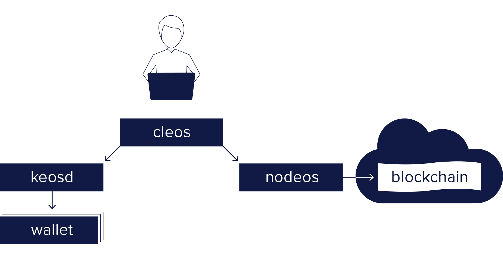

PureEOS is the next-generation blockchain platform for creating and deploying smart contracts and distributed applications. PureEOS comes with a number of programs. The primary ones included in PureEOS are the following:

* [Nodeos](01_nodeos/index.md) - Core service daemon that runs a node for block production, API endpoints, or local development.
* [Cleos](02_cleos/index.md) - Command line interface to interact with the blockchain (via `nodeos`) and manage wallets (via `keosd`).
* [Keosd](03_keosd/index.md) - Component that manages PureEOS keys in wallets and provides a secure enclave for digital signing.

The basic relationship between these components is illustrated in the diagram below.

Additional PureEOS Resources:
* [PureEOS Utilities](10_utilities/index.md) - Utilities that complement the PureEOS software.

[//]: # (THIS IS A COMMENT REMOVING BROKEN LINKS)
[//]: # (Upgrade-Guide-20_upgrade-guide/index.md-pureeos-version/protocol-upgrade-guide.)
[//]: # (Release Notes 30_release-notes/index.md  - All release notes for this PureEOS version.)

[[info | What's Next?]]
| [Install the PureEOS Software](00_install/index.md) before exploring the sections above.
